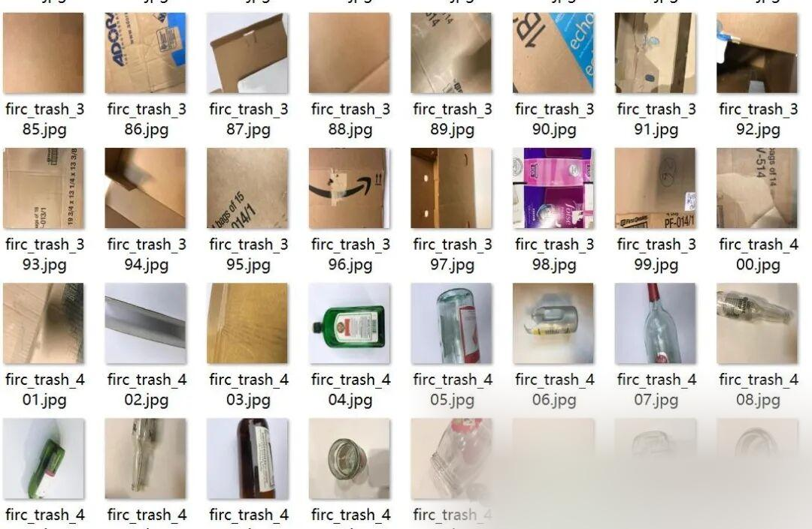
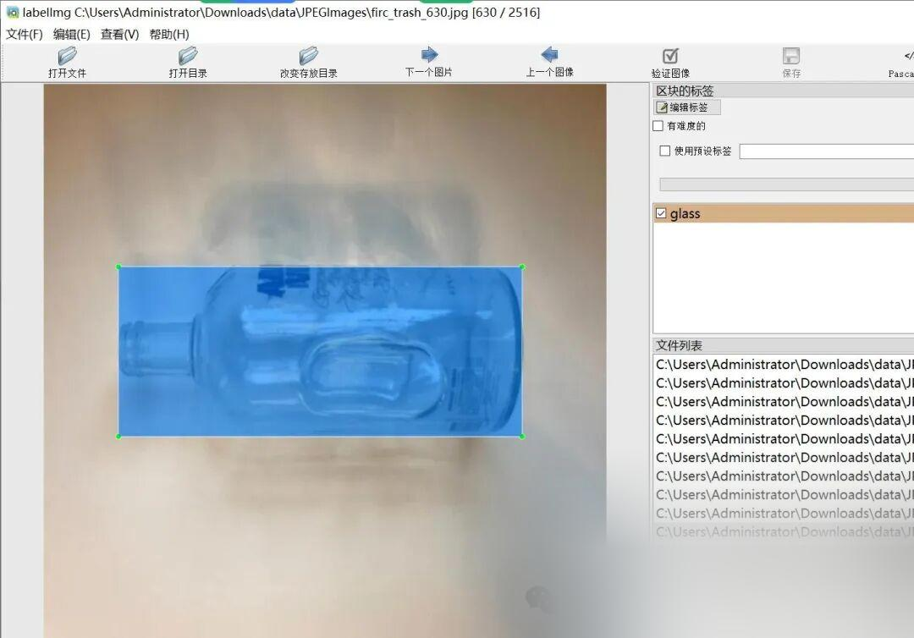

# VOC+YOLO format recyclable waste detection dataset with 2516 images in 6 categories for close-up shooting

Dataset format: Pascal VOC format + YOLO format (txt file without split path, only containing jpg images and corresponding VOC format xml files and yolo format txt files)

Number of images (number of jpg files): 2516

Number of annotations (number of xml files): 2516

Number of annotations (number of txt files): 2516

Label count: 6

Label category names (note that the order of yolo format categories does not correspond to this, but is based on the labels folder's classes.txt): ["cardboard", "glass", "metal", "paper", "plastic", "trash"]

Number of boxes labeled in each category:

Cardboard frame count = 407

Number of glass frames = 501

Metal frame count = 415

Number of paper frames = 591

Plastic frame count = 482

Trash frame count = 139

Total frame count: 2535

Using labelImg:

Annotation rules: Draw a rectangle around the category.

Important Notice: No

Special : This dataset does not guarantee the accuracy or precision of the trained models or weight files. The dataset is provided with accurate and reasonable annotations only.

Image Preview:

Annotation example:

## Payment

Here is a pay link on Stripe ( https://buy.stripe.com/3cs8yP7sY87d0vu9AB ). Please contact me lonlonago@foxmail.com after funding $89, and I will send you a complete data files , thank you!

